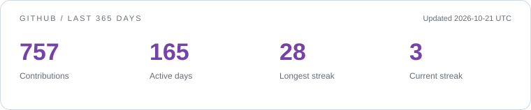
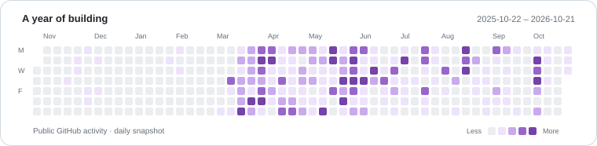

  

<em>𝓟𝓱𝓓 𝓼𝓽𝓾𝓭𝔂. @𝓒𝓤𝓗𝓚 𝓗𝓚𝓢𝓐𝓡</em>

  Research interests 
  <strong>Semantic data processing · AI systems LLM infrastructure · Agentic data systems</strong>

  <a href="https://sleepylgod.github.io/">🌐 Homepage</a> &nbsp;·&nbsp;
  <a href="https://rookiedong.gitbook.io/notes">📓 Notes</a> &nbsp;·&nbsp;
  <a href="https://www.linkedin.com/in/von-lu/">💼 LinkedIn</a> &nbsp;·&nbsp;
  <a href="mailto:haodong.lu.me@gmail.com">✉️ Email</a>

  

<!--
Previous profile details, preserved for future reuse:
- 🏆 [**First Prize, 17th “Challenge Cup”**](http://mse.hust.edu.cn/info/1180/11133.htm), National College Student Curricular Academic Science and Technology Works Competition.
- **[JumboArbitrage](https://github.com/JumboArbitrage)** & **[HUST-FOCUS](https://github.com/HUST-FOCUS)** — Organizations I founded.
- **[qwidget-demos](https://github.com/SleepyLGod/qwidget-demos)** — Qt components I built as a freshman at HUST.
-->

### Selected projects

<table>
  <tr>
    <td width="50%">
      <a href="https://github.com/SleepyLGod/agent-memory"><strong>agent-memory</strong></a> 
      Declarative agent memory with incremental semantic view maintenance.
    </td>
    <td width="50%">
      <a href="https://github.com/SleepyLGod/research-radar"><strong>research-radar</strong></a> 
      Research briefs grounded in full papers and source evidence.
    </td>
  </tr>
  <tr>
    <td width="50%">
      <a href="https://github.com/SleepyLGod/oh-my-score"><strong>oh-my-score</strong></a> 
      Audio-to-MIDI, piano playback, and code-to-MIDI sketches.
    </td>
    <td width="50%">
      <a href="https://github.com/SleepyLGod/Tonepath"><strong>Tonepath</strong></a> 
      A local music agent for explainable listening paths.
    </td>
  </tr>
</table>

### Toolbox

   &nbsp;
   &nbsp;
   &nbsp;
   &nbsp;
  <a href="https://pandas.pydata.org/"><picture><source media="(prefers-color-scheme: dark)" srcset="./assets/icons/pandas-dark.svg" /></picture></a> &nbsp;
  <a href="https://neo4j.com/"><picture><source media="(prefers-color-scheme: dark)" srcset="./assets/icons/neo4j-dark.svg" /></picture></a> &nbsp;
   &nbsp;
   &nbsp;
   &nbsp;
   &nbsp;
   &nbsp;

  <a href="https://arrow.apache.org/">Arrow</a> &nbsp;·&nbsp;
  <a href="https://github.com/lotus-data/lotus">LOTUS</a> &nbsp;·&nbsp;
  <a href="https://dspy.ai/">DSPy</a>

<!--
Additional tools from the earlier profile. Hidden for focus, not obsolete.

   &nbsp;
   &nbsp;
   &nbsp;
   &nbsp;
   &nbsp;
   &nbsp;
   &nbsp;
   &nbsp;
   &nbsp;
   &nbsp;
   &nbsp;
   &nbsp;
   &nbsp;

-->

🎧 <a href="https://open.spotify.com/user/31gepfdtbzi2ycsdpdthguc5z3cy">A little music beyond code</a>

<!--
Optional activity cards: archived because GitHub already displays a contribution
calendar. The generator remains available manually; there is no scheduled refresh.
## 📈 *𝓖𝓲𝓽𝓗𝓾𝓫 𝓐𝓬𝓽𝓲𝓿𝓲𝓽𝔂*

  <a href="https://github.com/SleepyLGod?tab=overview">
    <picture>
      <source media="(prefers-color-scheme: dark)" srcset="./assets/profile/activity-dark.svg" />
      
    </picture>
  </a>

  <a href="https://github.com/SleepyLGod?tab=overview">
    <picture>
      <source media="(prefers-color-scheme: dark)" srcset="./assets/profile/calendar-dark.svg" />
      
    </picture>
  </a>

-->

<!--
Spotify: no remote live card is embedded. A future authorized updater should
commit a dated listening snapshot to this repository and preserve its last
successful image on failure. Never add Spotify credentials to this README.
-->
