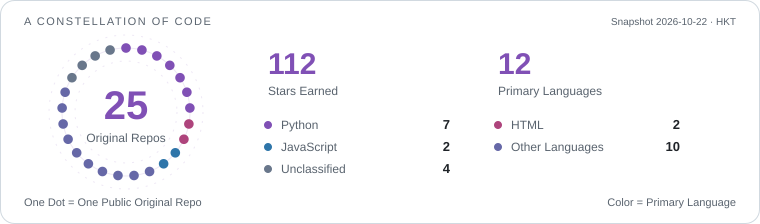

  

<em>𝓟𝓱𝓓 𝓢𝓽𝓾𝓭𝔂. @𝓒𝓤𝓗𝓚 𝓗𝓚𝓢𝓐𝓡</em>

  <em>𝓡𝓮𝓼𝓮𝓪𝓻𝓬𝓱 𝓘𝓷𝓽𝓮𝓻𝓮𝓼𝓽𝓼</em> 
  <strong>Semantic Data Processing · Agentic AI Systems · LLM Infrastructure · DBMS</strong>

  <a href="https://sleepylgod.github.io/">🌐 Homepage</a> &nbsp;·&nbsp;
  <a href="https://rookiedong.gitbook.io/notes">📓 Notes</a> &nbsp;·&nbsp;
  <a href="https://www.linkedin.com/in/von-lu/">💼 LinkedIn</a> &nbsp;·&nbsp;
  <a href="mailto:haodong.lu.me@gmail.com">✉️ Email</a>

  

<!--
Previous profile details, preserved for future reuse:
- 🏆 [**First Prize, 17th “Challenge Cup”**](http://mse.hust.edu.cn/info/1180/11133.htm), National College Student Curricular Academic Science and Technology Works Competition.
- **[JumboArbitrage](https://github.com/JumboArbitrage)** & **[HUST-FOCUS](https://github.com/HUST-FOCUS)** — Organizations I founded.
- **[qwidget-demos](https://github.com/SleepyLGod/qwidget-demos)** — Qt components I built as a freshman at HUST.
-->

<!--
Selected Projects: temporarily hidden; content preserved.
### *𝓢𝓮𝓵𝓮𝓬𝓽𝓮𝓭 𝓟𝓻𝓸𝓳𝓮𝓬𝓽𝓼*

<table>
  <tr>
    <td width="50%">
      <a href="https://github.com/SleepyLGod/agent-memory"><strong>agent-memory</strong></a> 
      Declarative agent memory with incremental semantic view maintenance.
    </td>
    <td width="50%">
      <a href="https://github.com/SleepyLGod/research-radar"><strong>research-radar</strong></a> 
      Research briefs grounded in full papers and source evidence.
    </td>
  </tr>
  <tr>
    <td width="50%">
      <a href="https://github.com/SleepyLGod/oh-my-score"><strong>oh-my-score</strong></a> 
      Audio-to-MIDI, piano playback, and code-to-MIDI sketches.
    </td>
    <td width="50%">
      <a href="https://github.com/SleepyLGod/Tonepath"><strong>Tonepath</strong></a> 
      A local music agent for explainable listening paths.
    </td>
  </tr>
</table>
-->

<h3 align="center"><em>𝓣𝓸𝓸𝓵𝓫𝓸𝔁</em></h3>

  
  
  
  
  
  
  
  
  
  
  
  
  
  
  
  
  
  
  
  
  
  
  
  

🎧 <a href="https://open.spotify.com/user/31gepfdtbzi2ycsdpdthguc5z3cy">A Little Music Beyond Code</a>

<h3 align="center"><em>𝓒𝓸𝓭𝓮 𝓐𝓽𝓵𝓪𝓼</em></h3>

  <a href="https://github.com/SleepyLGod?tab=repositories&amp;type=source">
    <picture>
      <source media="(max-width: 600px) and (prefers-color-scheme: dark)" srcset="./assets/profile/code-atlas-mobile-dark.svg" />
      <source media="(max-width: 600px)" srcset="./assets/profile/code-atlas-mobile-light.svg" />
      <source media="(prefers-color-scheme: dark)" srcset="./assets/profile/code-atlas-dark.svg" />
      
    </picture>
  </a>

<!--
Optional activity cards: archived because GitHub already displays a contribution
calendar. The generator remains available manually; there is no scheduled refresh.
## 📈 *𝓖𝓲𝓽𝓗𝓾𝓫 𝓐𝓬𝓽𝓲𝓿𝓲𝓽𝔂*

  <a href="https://github.com/SleepyLGod?tab=overview">
    <picture>
      <source media="(prefers-color-scheme: dark)" srcset="./assets/profile/activity-dark.svg" />
      
    </picture>
  </a>

  <a href="https://github.com/SleepyLGod?tab=overview">
    <picture>
      <source media="(prefers-color-scheme: dark)" srcset="./assets/profile/calendar-dark.svg" />
      
    </picture>
  </a>

-->

<!--
Spotify: no remote live card is embedded. A future authorized updater should
commit a dated listening snapshot to this repository and preserve its last
successful image on failure. Never add Spotify credentials to this README.
-->
